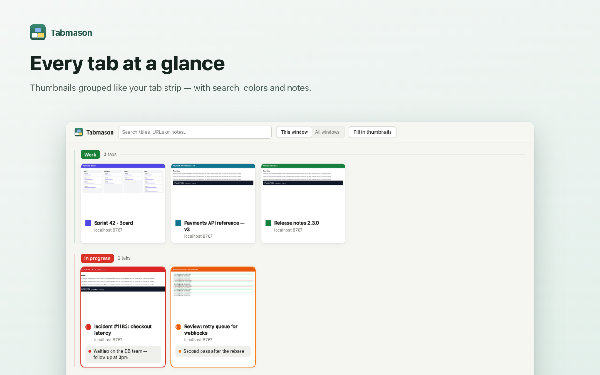
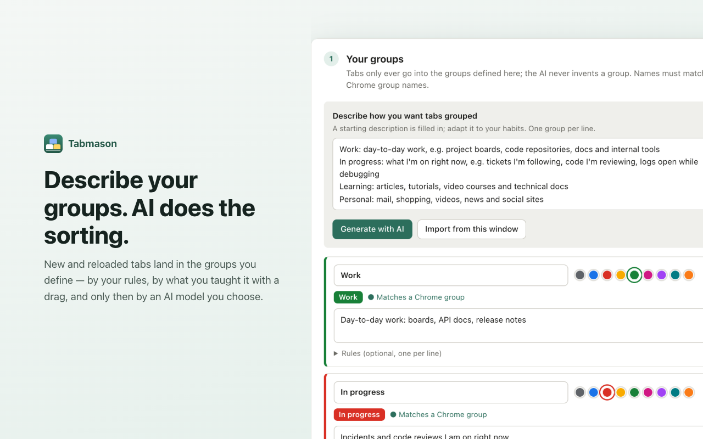
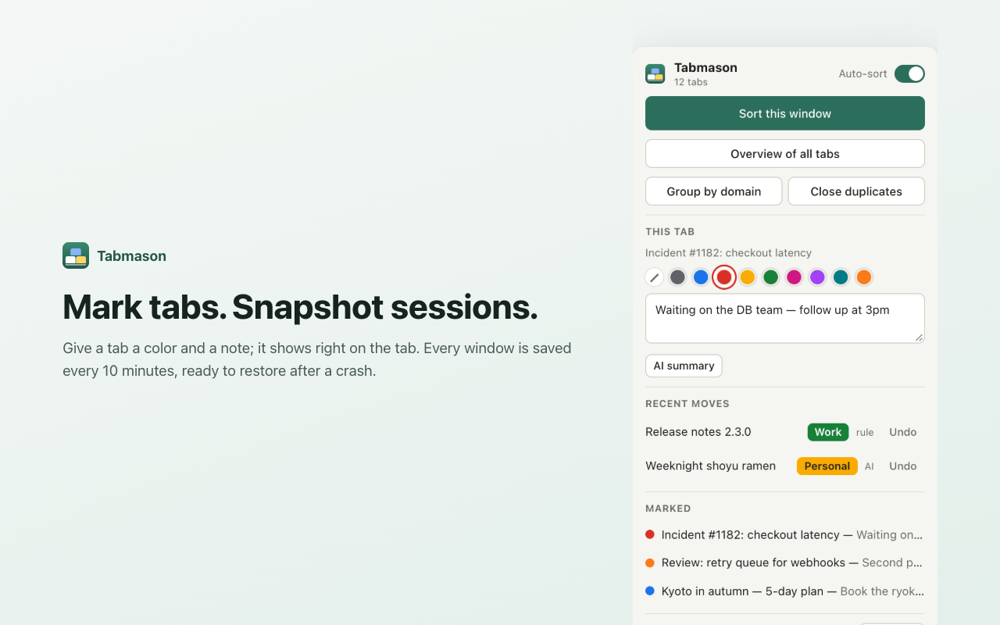
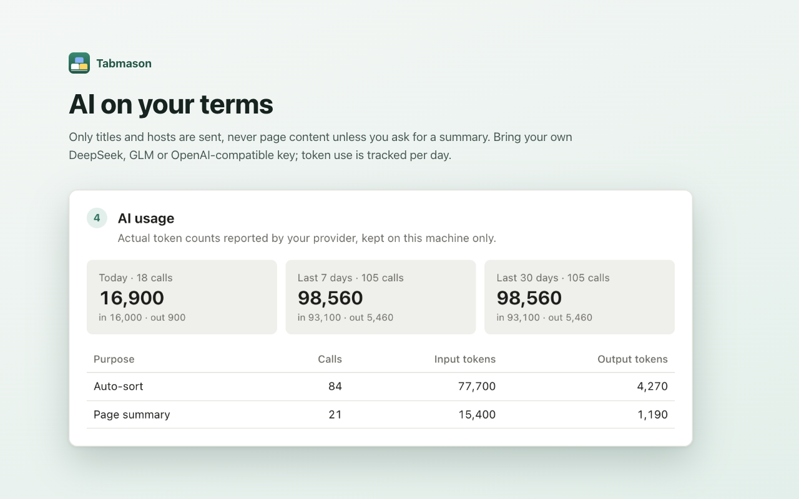

<p align="center">
  
</p>

<h1 align="center">Tabmason</h1>

<p align="center">
  <b>A Chrome extension that sorts your tabs into the groups <i>you</i> define — automatically.</b><br>
  Mark tabs with colors and notes, see every tab at a glance, and snapshot your windows so a crash never costs you a session.
</p>

<p align="center">
  <a href="README.zh-CN.md">中文说明</a> ·
  <a href="#install">Install</a> ·
  <a href="#features">Features</a> ·
  <a href="#privacy">Privacy</a> ·
  <a href="#faq">FAQ</a>
</p>

<p align="center">
  
</p>

## What it is

Tabmason is a Manifest V3 Chrome extension for people who live in tab groups. You decide what your groups are ("Work", "In progress", "Personal"…); Tabmason keeps new and reloaded tabs in them, so you stop dragging tabs around by hand. It works without AI, and when it does use AI it uses a cheap model **you** choose (DeepSeek, Zhipu GLM, OpenAI or any OpenAI-compatible API) with your own key.

- **No account, no server, no tracking.** Everything stays in your browser.
- **Chinese and English** interface.
- Plain JavaScript, no build step.

## Features

### Auto-sort tabs into your own groups
- Describe your groups in plain words and let AI draft them, or import the named groups already in your window.
- When a tab finishes loading, Tabmason puts it into one of **your** groups. It never invents a group.
- Decision order, cheapest first:
  1. **Learned rules** — when you drag a tab into a group, Tabmason remembers `host/first-path-segment → group`.
  2. **Your rules** — `host:example.com`, `url:/merge_requests`, `title:keyword`.
  3. **Cached AI answers** for the same kind of page.
  4. **AI** — only for what's left; low-confidence answers become suggestions in the popup instead of moves.
- Every automatic move can be undone from the popup (and undoing teaches it).



### Mark tabs with colors and notes
- Give any tab a color and a one-line note from the popup, or let AI write a short summary of the page.
- The tab's favicon gets a **colored ring**, and optionally a colored dot in front of the title, so you can find it even when tabs shrink to icons.
- Optionally append the note to the title so it shows in **Chrome's tab hover card**.
- Marks are keyed by URL and survive restarts. Works on web pages and local `file://` pages.

### Overview of every tab
- Popup button or **`Alt+Shift+O`**: all open tabs as thumbnail cards, grouped like your tab strip (pinned → groups → ungrouped), with search across titles, URLs and notes.
- Thumbnails are captured locally whenever you view a tab; "Fill in thumbnails" visits the rest once.

### Snapshots
- All windows (tabs, groups with names/colors/collapsed state, pinned tabs) are saved **every 10 minutes** (skipped when nothing changed; the newest 24 are kept) and whenever you click **Save now**.
- Restore after a restart or a crash. Groups and pinned tabs come back; background tabs load only when you open them.



### AI on your terms
- Bring your own key; switch provider any time. Presets: DeepSeek `deepseek-chat`, Zhipu `glm-4-flash`, OpenAI `gpt-4o-mini`, or any custom OpenAI-compatible endpoint.
- Sorting sends **only tab titles, hosts and paths** — never page content. Page text is sent only when you click **AI summary**.
- Hosts in **Never send to AI** (default: `localhost`, `127.0.0.1`) are never sent.
- Real token usage per day and per purpose is shown on the settings page. Typical use is a few tens of thousands of tokens a day; check your provider's pricing page for what that costs.



## Install

**Chrome Web Store:** coming soon.

**From source (developer mode):**

1. Clone this repository: `git clone https://github.com/aiwatching/Tabmason.git`
2. Open `chrome://extensions` and turn on **Developer mode**.
3. Click **Load unpacked** and select the `Tabmason` folder.
4. Pin Tabmason from the extensions menu, open its **Settings**, and:
   - (optional) pick an AI provider and paste your API key, then **Test connection**;
   - under **Your groups**, adjust the description and click **Generate with AI**, or **Import from this window**; then **Save groups**.
5. For local files, turn on **Allow access to file URLs** on Tabmason's details page.

## Keyboard shortcuts

| Shortcut | Action |
|---|---|
| `Alt+Shift+O` | Open the tab overview |
| `Alt+Shift+G` | Group tabs in this window by domain |

Change them at `chrome://extensions/shortcuts`.

## Privacy

Tabmason has no server and collects nothing. Group definitions, learned rules, marks, thumbnails, snapshots, settings and your API key are stored only in your browser. Data leaves your device only when you configure an AI provider, and then goes directly from your browser to that provider. Full details: [PRIVACY.md](PRIVACY.md).

## FAQ

**Does it work without an AI key?**
Yes. Your rules and the rules it learns from your drags do the sorting; without a key, tabs it can't place simply stay where they are.

**Will it create groups I didn't ask for?**
No. Tabs only go into the groups you defined. If such a group isn't open in a window yet, it is created there with the name and color you chose.

**Why does the favicon of a marked tab have a colored ring?**
Chrome doesn't let extensions color an individual tab, so Tabmason marks the tab's icon (and optionally its title) instead.

**Can the note show when I hover over a tab?**
Yes: turn on *Append the note to the title* in Settings. Chrome's hover card shows the title, so the note appears there.

**Chrome crashed / I closed a window by mistake. Can I get my tabs back?**
Open the popup, pick the latest snapshot and click **Restore**. Snapshots are taken every 10 minutes.

**How much does the AI cost?**
Most tabs are sorted by rules and cache. A typical day is a few dozen AI calls of about 1,000 tokens each; the exact numbers are on the settings page.

**Which pages can't be marked or captured?**
`chrome://` pages, the new tab page and the Chrome Web Store don't allow extensions in; marks for them still appear in the overview and the popup's Marked list.

## Project layout

```
manifest.json          extension manifest (MV3)
src/background.js      service worker: message handlers, keyboard commands
src/auto/engine.js     auto-sorting: tab events, batching, moving, learning from drags
src/auto/classifier.js rules / learned / cache / AI classification; text → group plan
src/sw/marks.js        ringed favicons, AI page summaries, content-script sync
src/sw/thumbnails.js   thumbnail capture and "fill in thumbnails"
src/sw/snapshots.js    periodic and manual snapshots, restore
src/content/mark.js    content script: shows a tab's mark (favicon ring, title dot, note)
src/overview/          tab overview page
src/popup/             toolbar popup
src/options/           settings: groups, AI, behavior, usage, learned rules
src/lib/               storage, i18n (zh/en), LLM client, marks, thumbnails (IndexedDB)
src/ui/theme.css       shared design tokens (light/dark) and components
icons/                 icon.svg source + rendered PNGs
store/                 Chrome Web Store screenshots and promo tiles (en, zh)
scripts/               package.sh (store zip), render-icons.mjs
```

## Development

- After editing, press the reload button on the Tabmason card in `chrome://extensions`.
- `scripts/package.sh` builds `dist/tabmason-<version>.zip` for the Chrome Web Store.
- Store submission details (listing text, permission justifications, data disclosures): [STORE.md](STORE.md).

Issues and ideas: https://github.com/aiwatching/Tabmason/issues

## License

[MIT](LICENSE)
