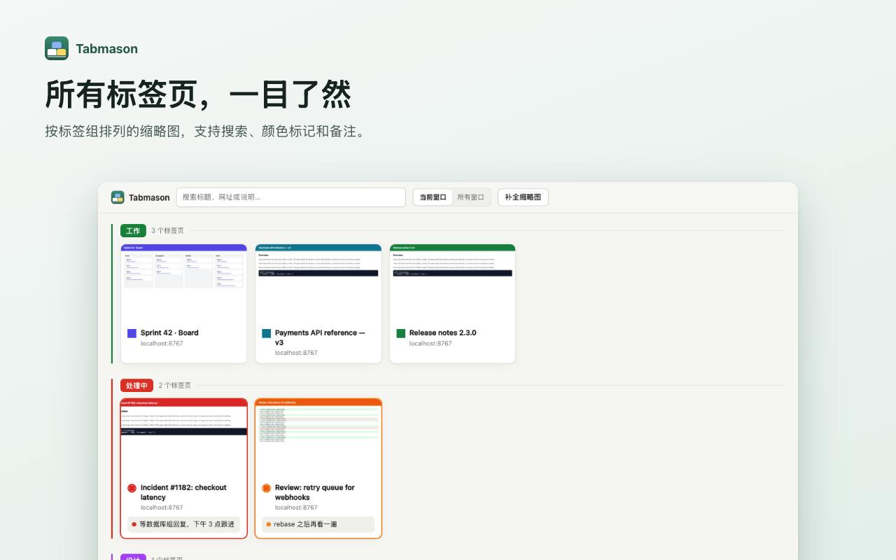

  

<h1 align="center">Tabmason</h1>

  <b>把 Chrome 标签页自动放进<i>你自己定义</i>的分组。</b> 
  给标签页加颜色和备注、所有标签页一目了然、定时快照，Chrome 崩溃也不怕丢标签。

  <a href="README.md">English</a> ·
  <a href="#安装">安装</a> ·
  <a href="#功能">功能</a> ·
  <a href="#隐私">隐私</a> ·
  <a href="#常见问题">常见问题</a>

  

## 这是什么

Tabmason 是一个 Chrome 扩展（Manifest V3），给习惯用标签组的人用。你决定有哪些组（“工作”“处理中”“个人”……），Tabmason 负责把新开和刷新的标签页放进去，不用再手动拖。不用 AI 也能工作；需要 AI 时，用的是**你自己选的**便宜模型（DeepSeek、智谱 GLM、OpenAI 或任何 OpenAI 兼容接口）和你自己的 key。

- **无账号、无服务器、无追踪**，数据都在你的浏览器里。
- 支持**中文和英文**界面。
- 纯 JavaScript，无需构建。

## 功能

### 按你的分组自动归类
- 用一句话描述你的分组，让 AI 生成；或直接导入当前窗口已有的组。
- 标签页加载完成后，自动放进**你定义的**某个组，绝不自己新建组。
- 判断顺序，从便宜到贵：
  1. **学到的规则**：你把标签页拖进某个组时，记下“域名/第一级路径 → 组”；
  2. **你写的规则**：`host:example.com`、`url:/merge_requests`、`title:关键词`；
  3. **之前 AI 判断的缓存**；
  4. **AI**：只处理剩下的；没把握的只在弹窗里给建议，不自动移动。
- 每次自动移动都能在弹窗里撤销（撤销也会让它学习）。

### 给标签页加颜色和备注
- 在弹窗里给任意标签页选颜色、写一句备注，或让 AI 生成页面概要。
- 网站图标外加一圈颜色，可选在标题前加彩色圆点，标签窄到只剩图标也能认出来。
- 可选把备注附在标题后面，鼠标悬停时 **Chrome 的预览卡片**里就能看到。
- 标记按网址保存，重启后还在；网页和本地 `file://` 文件都支持。

### 概览所有标签页
- 弹窗按钮或 **`Alt+Shift+O`**：所有标签页按标签栏的分组排成缩略图卡片（已固定 → 各组 → 未分组），可搜索标题、网址和备注。
- 你看过的标签页会在本地自动截缩略图；“补全缩略图”可以一次补齐。

### 快照
- **每 10 分钟**自动保存所有窗口（标签页、分组的名称/颜色/折叠状态、固定标签），没变化就跳过，保留最近 24 份；也可以随时点“保存当前”。
- 重启或崩溃后一键恢复，分组和固定标签都会还原，后台标签页点开才加载。

### AI 由你掌控
- 用你自己的 key，随时切换服务商。预设模型：DeepSeek `deepseek-chat`、智谱 `glm-4-flash`、OpenAI `gpt-4o-mini`，或自定义 OpenAI 兼容接口。
- 归类**只发送标签页标题、域名和路径**，不发页面内容；只有点 **AI 概要** 时才发送页面正文。
- “不发给 AI 的域名”（默认 `localhost`、`127.0.0.1`）永远不会发送。
- 设置页按天、按用途显示实际 token 用量。日常使用一天大约几万 token，具体费用以服务商官网价格为准。

## 安装

**Chrome 网上应用店：** 即将上架。

**从源码安装（开发者模式）：**

1. 克隆仓库：`git clone https://github.com/aiwatching/Tabmason.git`
2. 打开 `chrome://extensions`，打开右上角的“开发者模式”。
3. 点“加载已解压的扩展程序”，选择 `Tabmason` 文件夹。
4. 把 Tabmason 固定到工具栏，打开“设置”：
   - （可选）选择 AI 服务商、填 API key，点“测试连接”；
   - 在“我的分组”里修改描述后点“AI 生成分组”，或点“从当前窗口导入”，然后“保存分组”。
5. 本地文件需要在扩展详情页打开“允许访问文件网址”。

## 快捷键

| 快捷键 | 作用 |
|---|---|
| `Alt+Shift+O` | 打开标签页概览 |
| `Alt+Shift+G` | 当前窗口按域名分组 |

可以在 `chrome://extensions/shortcuts` 修改。

## 隐私

Tabmason 没有服务器，不收集任何数据。分组、学到的规则、标记、缩略图、快照、设置和 API key 都只保存在你的浏览器里。只有在你配置了 AI 服务商之后，数据才会离开设备，并且直接从浏览器发给该服务商。详见 [PRIVACY.md](PRIVACY.md)。

## 常见问题

**没有 AI key 能用吗？**
能。你的规则和从拖拽学到的规则负责归类；没有 key 时，判断不了的标签页保持原样。

**会不会建我没要的组？**
不会。标签页只会进你定义的组；如果某个窗口里还没有这个组，会按你设的名字和颜色在那个窗口里建一个。

**为什么标记过的标签图标外面有一圈颜色？**
Chrome 不允许扩展改单个标签的底色，所以改为标记图标（和可选的标题前缀）。

**鼠标悬停时能看到备注吗？**
能：在设置里打开“在标题里附带备注”。悬停卡片显示的是标题，备注就在里面。

**Chrome 崩溃了 / 误关了窗口，标签页能找回来吗？**
打开弹窗，在“快照”里选最近一份，点“恢复”。快照每 10 分钟自动保存一次。

**AI 花多少钱？**
大部分标签页靠规则和缓存归类。一般一天几十次 AI 调用，每次约 1000 token；准确数字在设置页的“AI 用量”里。

**哪些页面不能标记或截图？**
`chrome://` 页面、新标签页和 Chrome 网上应用店不允许扩展访问；这些页面的标记仍会出现在概览页和弹窗的“已标记”列表里。

## 开发

- 修改代码后，在 `chrome://extensions` 里点 Tabmason 卡片上的刷新按钮。
- `scripts/package.sh` 打包出 `dist/tabmason-<版本>.zip`，用于上传到 Chrome 网上应用店。
- 上架资料（介绍文字、权限说明、数据声明）见 [STORE.md](STORE.md)。

问题和建议：https://github.com/aiwatching/Tabmason/issues

## 许可证

[MIT](LICENSE)
